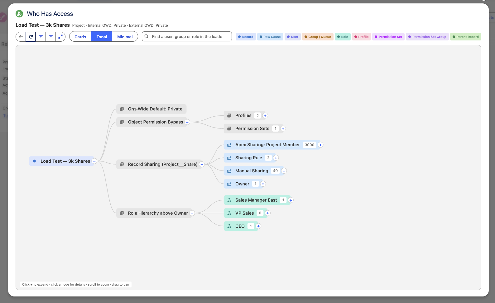
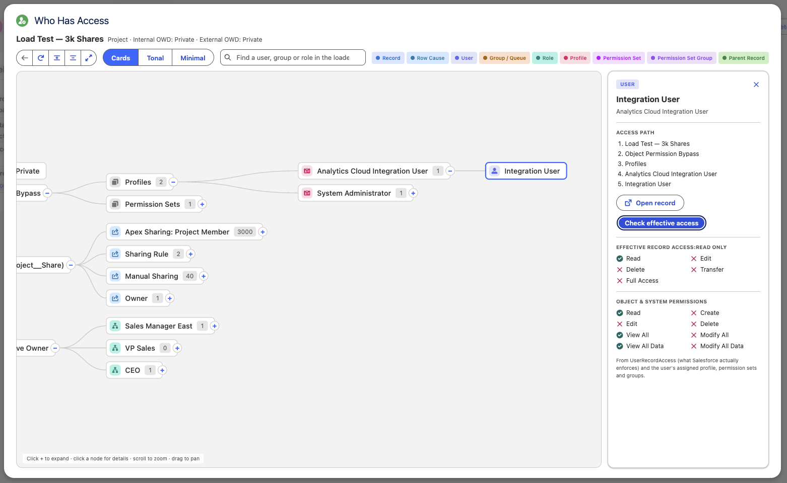
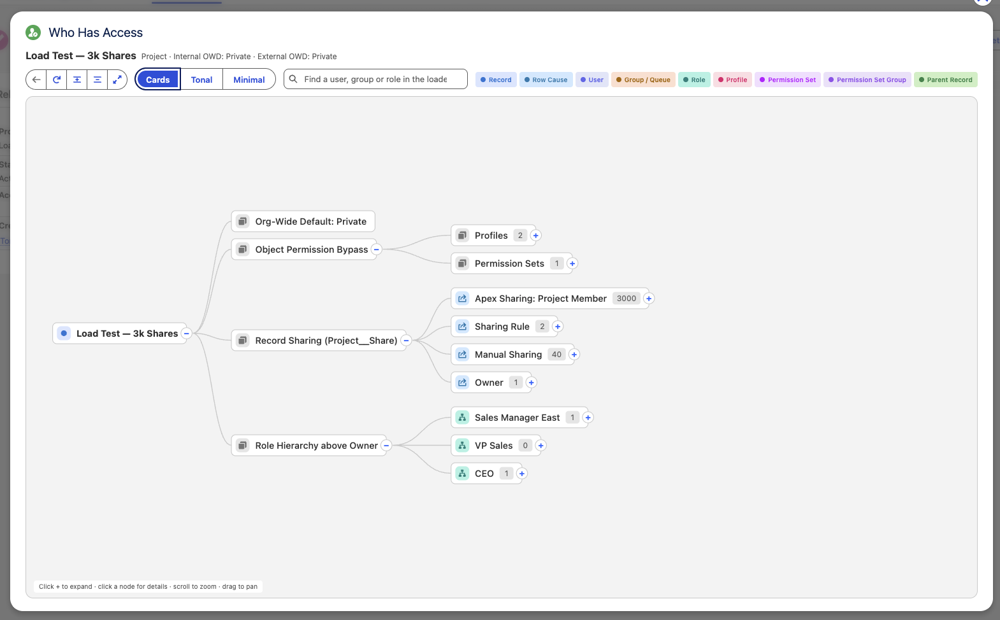

# Who Has Access

**Who Has Access** is a Salesforce Lightning Web Component that answers one question for any record: *who can access this record, and why?*

It draws an interactive tree from the record down to the individual users who have access. Along the way it shows each path:
- the org-wide default sharing setting
- View All / Modify All permissions that bypass sharing
- every share row, grouped by row cause
- public groups, queues, roles and territories
- the role hierarchy above the owner

Click any user to see their effective access, the same check Salesforce itself enforces.

It is built on Apex and D3.js, styled with SLDS 2 (Cosmos), and tested against Salesforce's recommended scale limits.

---

## Preview

Demo : [](https://youtu.be/aPX4bgKxn3A)


<table>
  <tr>
    <td align="center"><b>1</b></td>
    <td align="center"><b>2</b></td>
    <td align="center"><b>3</b></td>
  </tr>
  <tr>
    <td><a href="images/1.png"></a></td>
    <td><a href="images/2.png"></a></td>
    <td><a href="images/3.png"></a></td>
  </tr>
</table>

<sub>Click an image to view it full size.</sub>

---

## Features

- **Complete access tree:** org-wide default, object-level bypass, share table, groups, roles and role hierarchy.
- **Every row cause:** labels come from your org's own schema, so all standard and Apex sharing reasons are covered.
- **Every group type:** public groups, queues, roles, role and subordinates, managers, territories, Chatter groups, and portal or partner groups.
- **Effective access check:** shows Read, Edit, Delete, Transfer and Full from `UserRecordAccess`, next to the user's object permissions.
- **Built for scale:** large lists load 200 at a time. Measured on a record shared to 3,000 groups, the tree opened with 16 SOQL queries.
- **SLDS 2 styling:** three node styles (Cards, Tonal, Minimal), dark-mode ready, with search that centres on the match.
- **Secure by design:** only users with the custom permission can open it, and only for records they can already read.

---

## Installation

### Option 1: Deploy the source code

```bash
git clone <this-repository-url>
cd WhoHasAccess
sf project deploy start -d force-app -o <YOUR_ORG>
```

### Option 2: Install the unlocked package

If you want to keep the code separate from your own metadata, install the unlocked package:

```bash
sf package install -p 04tdL000000qzXFQAY -o <YOUR_ORG> -w 10
```

---

## Configuration

1. **Assign the permission set.** Give `Who_Has_Access` to the users who should see the tool, such as admins and architects:
   ```bash
   sf org assign permset -n Who_Has_Access -o <YOUR_ORG> -b <username>
   ```
2. **Create a quick action** on any object:
   **Setup → Object Manager → *Your Object* → Buttons, Links, and Actions → New Action**
   - Action Type: **Lightning Web Component**
   - Lightning Web Component: **c:whoHasAccessAction**
   - Label: `Who Has Access`
3. **Add the quick action to the page layout.** Open the object's page layout and drag **Who Has Access** into the *Salesforce Mobile and Lightning Experience Actions* section.

You can also use the **Who Has Access** tab and paste any record Id, or drop the component onto a Lightning record page in App Builder.

---

## Contributing

Contributions are welcome.

1. Fork the repository and create a branch from `develop`.
2. Run the checks before opening a pull request:
   ```bash
   npm install
   npm run lint
   npm run test:unit
   sf apex run test -n WhoHasAccessControllerTest -c -r human -o <YOUR_ORG>
   ```
3. Keep Apex coverage at or above 80%, and use SLDS 2 styling hooks (`--slds-g-*`) rather than hard-coded colours.

To report a bug or suggest an idea, open an issue.

---

## License

Released under the [MIT License](LICENSE).

D3.js is included as a static resource under its own [ISC License](https://github.com/d3/d3/blob/main/LICENSE).

---

## Disclaimer

This project has been reviewed for common vulnerabilities and security risks. It is still provided **"as is"**, without warranty of any kind.

Before installing in a production org:
- deploy and test it in a sandbox first;
- review the code against your organisation's security policies;
- assign the `Who_Has_Access` permission set only to trusted users. The tool reveals who can see which records.

The authors are not liable for any data exposure, loss or damage arising from its use.
